# Activity diagram: FR-04 quality rules, version 1 (Increment 2)

```
Basis: team convention (diagrams/README.md: drawn from develop); DESIGN-INC2 section 2; P-01, P-08
Source of truth: backend/services/quality_rules.py (constants, evaluate, _verdict, _timed_answers, _question_medians,
  _speeding, score, band), backend/services/quality_service.py (evaluate_survey, _rules_input)
Date / version: 2026-11-20, develop commit f3c96d4
```

`quality_rules.evaluate` turns the stored evidence of every submitted response of one survey into one verdict per
response. `QualityService.evaluate_survey` calls it each time the provider opens the response quality panel, after the
owner check and only once the survey's results are open. The diagram follows the code in the order it runs: the
survey-wide steps once, then `_verdict` for each response.

```mermaid
flowchart TD
    S(["evaluate: the evidence rows of every submitted response of one survey"]) --> T

    subgraph ONCE["Once per survey"]
        T["Timed answers of each response: its timings for the questions it answered"] --> C
        C["Count the responses whose evidence has signals_ok"] --> CM{"Count at least RSI_MIN_RESPONSES = 20?"}
        CM -- yes --> MD["Median active_ms per question over the timed answers of those responses"]
        CM -- no --> NM["No medians: rule b cannot run for any response"]
        MD --> G
        NM --> G
        G["Group the respondents by device_hash"]
    end

    G --> N

    subgraph EACH["Per response, in input order: _verdict"]
        N["Next response"] --> EV{"Evidence row exists?"}
        EV -- no --> BC["status BEFORE_CHECKS: no flag, no not_checked, no score, no band"]

        EV -- yes --> AT{"attention_total at least 1?"}
        AT -- no --> ATN["ATTENTION_FAILED not checked"]
        AT -- yes --> ATF{"attention_failed at least 1?"}
        ATF -- yes --> ATY["Flag ATTENTION_FAILED"]
        ATF -- no --> SG
        ATN --> SG
        ATY --> SG

        SG{"signals_ok?"}
        SG -- no --> SM["Flag SIGNALS_MISSING and SPEEDING not checked: the timings are not trusted"]
        SG -- yes --> RA{"Rule a, the floor: at least FLOOR_MIN_TIMED_CLOSED = 3 timed closed answers?"}
        RA -- yes --> RAR["Rule a result: the share of those answers under FAST_ANSWER_MS = 2,000 ms is at least FAST_SHARE = 0.5"]
        RA -- no --> RB
        RAR --> RB
        RB{"Rule b, the relative speed index: medians exist and the response has timed answers?"}
        RB -- yes --> RBR["Rule b result: mean factor at least RSI_THRESHOLD = 2.0, factor = median / own time, own time at least 100 ms, factor at most 3"]
        RB -- no --> SR
        RBR --> SR
        SR{"Rule a or rule b ran?"}
        SR -- neither --> SPN["SPEEDING not checked"]
        SR -- yes --> SPT{"Either result true?"}
        SPT -- yes --> SPY["Flag SPEEDING"]
        SPT -- no --> DV
        SPN --> DV
        SPY --> DV
        SM --> DV

        DV{"The response has a device_hash?"}
        DV -- no --> DVN["DUPLICATE_DEVICE not checked"]
        DV -- yes --> DVO{"Another respondent of this survey has the same hash?"}
        DVO -- yes --> DVY["Flag DUPLICATE_DEVICE"]
        DVO -- no --> RT
        DVN --> RT
        DVY --> RT

        RT{"rating_count at least STRAIGHT_LINING_MIN_RATINGS = 5?"}
        RT -- no --> RTN["STRAIGHT_LINING not checked"]
        RT -- yes --> RTS{"rating_all_same?"}
        RTS -- yes --> RTY["Flag STRAIGHT_LINING"]
        RTS -- no --> SC
        RTN --> SC
        RTY --> SC

        SC["score = MAX_SCORE 100 minus the penalties of the flags, never under 0"] --> BD{"score"}
        BD -- "100" --> CL["band CLEAN"]
        BD -- "CHECK_MIN_SCORE 60 to 99" --> CK["band CHECK"]
        BD -- "under 60" --> LW["band LOW"]
        CL --> VD
        CK --> VD
        LW --> VD
        VD["status evaluated: flags and not_checked in FLAG_CODES order, score, band"]

        BC --> MR
        VD --> MR
        MR{"More responses?"}
        MR -- yes --> N
    end

    MR -- no --> R(["Return one verdict per response, in input order"])
```



## Penalties (`score`)

| Flag | Penalty | Constant |
|---|---|---|
| ATTENTION_FAILED | 40 per failed attention check, at most 2 counted (at most 80) | `ATTENTION_PENALTY`, `ATTENTION_PENALTY_MAX_FAILED` |
| SPEEDING | 30 | `SPEEDING_PENALTY` |
| SIGNALS_MISSING | 30 | `SIGNALS_MISSING_PENALTY` |
| DUPLICATE_DEVICE | 20 | `DUPLICATE_DEVICE_PENALTY` |
| STRAIGHT_LINING | 10 | `STRAIGHT_LINING_PENALTY` |

A rule marked "not checked" costs nothing: only a flag lowers the score. Bands (`band`): `CLEAN` at 100, `CHECK`
from `CHECK_MIN_SCORE` (60) to 99, `LOW` under 60.

## Legend

| Symbol | Meaning |
|---|---|
| Rounded box (stadium) | Start or end of `evaluate`. |
| Rectangle | Action: a step of the code. |
| Diamond | Decision; the labels on the outgoing lines are the answers. |
| Frame "Once per survey" | Steps of `evaluate` that run once, before any verdict. |
| Frame "Per response" | `_verdict`, run for each response; the line back to "Next response" is the loop. |
| Flag | A rule ran and found the problem; the code is added to `flags`. |
| Not checked | The rule could not run on this response's evidence; the code is added to `not_checked`. |
| Timed answer | An answered question that has an `active_ms` in the evidence `timings`. |
| Closed answer | An answer to a MULTIPLE_CHOICE or RATING_SCALE question (`CLOSED_QUESTION_TYPES`). |
| `NAME = value` | Constant of `quality_rules.py` and its value. |

The flags, the score and the band are derived on read from the stored evidence (`response_quality`) every time they
are shown; none of them is stored (P-01). The rules are `RULES_VERSION` 1, and the version is returned with every
evaluation. The rules read the evidence of every submitted response, whatever the provider included or excluded, so
excluding or including a response never changes a verdict (P-08); nothing is excluded automatically.
