# Class diagram: domain model (Increment 2)

```
Basis: team convention (diagrams/README.md: requirement IDs and layer names)
Source of truth: backend/apps/core/models/ (eleven model files: user.py, respondent_profile.py, survey.py,
  targeting_criteria.py, question.py, question_option.py, response.py, response_draft.py, response_quality.py,
  answer.py, sentiment_analysis_result.py), backend/core/enums.py
Date / version: 2026-11-27, develop commit 59f1957
```

The eleven domain classes of `apps.core`, their key attributes, the methods that hold business rules, and the
enumerations they use. Attribute types are the Python types of the Django fields. Changes since Increment 1
(develop d3d2db2): the sentiment worker fields (T-9), the targeting lists and the reach at publish (FR-03), and the
response quality evidence, attention questions, include or exclude decision and profile snapshot (FR-04). Changes
since the FR-04 version (develop f3c96d4): the shuffle switches (FR-16, migration 0014), the admin review (FR-12,
0015), the schedule and response limit with the PAUSED state (FR-11, 0016), and the email confirmation flag (FR-15,
0017).

```mermaid
classDiagram
    direction TB

    class User {
        +int user_id
        +str name
        +str email
        +UserType user_type
        +AccountStatus account_status
        +bool is_active
        +bool email_verified
        +datetime created_at
        +activate()
        +suspend()
        +mark_deleted()
    }

    class RespondentProfile {
        +int profile_id
        +int age
        +Gender gender
        +Governorate region
        +list~Interest~ interests
        +Education education
        +Occupation occupation
        +MaritalStatus marital_status
        +datetime updated_at
        +clean()
        +update_profile(age, gender, region, interests, education, occupation, marital_status)
        +is_complete() bool
        +completion_percent() int
    }

    class Survey {
        +int survey_id
        +str title
        +str description
        +SurveyStatus status
        +datetime created_at
        +datetime? published_at
        +datetime? closed_at
        +int? reach_at_publish
        +bool shuffle_questions
        +bool shuffle_options
        +datetime? submitted_at
        +datetime? reviewed_at
        +str rejection_reason
        +date? opens_on
        +date? closes_on
        +int? target_responses
        +clean()
        +submit_for_review()
        +approve(admin_user)
        +reject(admin_user, reason)
        +publish()
        +pause()
        +resume()
        +close()
        +is_pending_review() bool
        +is_open_on(day) bool
        +has_passed_closing(day) bool
        +can_edit() bool
        +can_delete() bool
        +can_accept_responses() bool
    }

    class TargetingCriteria {
        +int criteria_id
        +Gender? gender
        +int? age_min
        +int? age_max
        +list~Governorate~ regions
        +list~Education~ education_levels
        +list~Occupation~ occupations
        +list~MaritalStatus~ marital_statuses
        +list~Interest~ interests
        +is_open_to_all() bool
    }

    class Question {
        +int question_id
        +str question_text
        +QuestionType question_type
        +bool is_required
        +int order_index
        +bool is_attention_check
        +int? expected_rating
        +is_choice_based() bool
        +is_open_text() bool
    }

    class QuestionOption {
        +int option_id
        +str option_text
        +int order_index
    }

    class Response {
        +int response_id
        +datetime? started_at
        +datetime submitted_at
        +bool is_excluded
        +datetime? excluded_at
        +int? snap_age
        +str snap_gender
        +str snap_region
        +str snap_education
        +str snap_occupation
        +str snap_marital_status
        +list~str~ snap_interests
        +add_answer(answer) Answer
        +has_open_text_answers() bool
    }

    class ResponseDraft {
        +int draft_id
        +list~dict~ answers
        +list~dict~ timings
        +datetime started_at
        +datetime updated_at
    }

    class ResponseQuality {
        +int quality_id
        +list~dict~ timings
        +int? active_ms
        +int attention_total
        +int attention_failed
        +int rating_count
        +bool rating_all_same
        +str device_hash
        +bool signals_ok
    }

    class Answer {
        +int answer_id
        +str? answer_value
        +int? rating_value
        +is_textual() bool
        +is_rating_based() bool
        +is_option_based() bool
        +requires_sentiment_analysis() bool
    }

    class SentimentAnalysisResult {
        +int result_id
        +SentimentLabel? sentiment_label
        +float? sentiment_score
        +AnalysisStatus status
        +datetime? analyzed_at
        +int attempts
        +datetime? next_attempt_at
        +datetime? locked_at
        +str error_code
        +str language
        +str model_id
        +mark_completed(label, score, analyzed_at, language, model_id)
        +mark_failed(error_code)
        +mark_skipped(error_code)
        +schedule_retry(next_attempt_at)
    }

    class UserType {
        <<enumeration>>
        SERVICE_PROVIDER
        RESPONDENT
        ADMIN
    }

    class AccountStatus {
        <<enumeration>>
        ACTIVE
        SUSPENDED
        DELETED
    }

    class SurveyStatus {
        <<enumeration>>
        DRAFT
        PENDING_REVIEW
        PUBLISHED
        PAUSED
        CLOSED
    }

    class QuestionType {
        <<enumeration>>
        MULTIPLE_CHOICE
        RATING_SCALE
        OPEN_TEXT
    }

    class AnalysisStatus {
        <<enumeration>>
        PENDING
        RUNNING
        COMPLETED
        FAILED
        SKIPPED
    }

    class SentimentLabel {
        <<enumeration>>
        POSITIVE
        NEGATIVE
        NEUTRAL
    }

    class Gender {
        <<enumeration>>
        MALE
        FEMALE
        ANY
    }

    class Governorate {
        <<enumeration>>
        15 values
    }

    class Interest {
        <<enumeration>>
        12 values
    }

    class Education {
        <<enumeration>>
        7 values
    }

    class Occupation {
        <<enumeration>>
        9 values
    }

    class MaritalStatus {
        <<enumeration>>
        5 values
    }

    User "1" *-- "0..1" RespondentProfile : respondent_profile
    Survey "1" *-- "0..1" TargetingCriteria : criteria
    Survey "1" *-- "0..*" Question : questions
    Survey "1" *-- "0..*" Response : responses
    Survey "1" *-- "0..*" ResponseDraft : drafts
    Question "1" *-- "0..*" QuestionOption : options
    Response "1" *-- "0..*" Answer : answers
    Response "1" *-- "0..1" ResponseQuality : quality
    User "1" -- "0..*" Survey : provider
    User "0..1" -- "0..*" Survey : reviewed_by
    User "1" -- "0..*" Response : respondent
    User "1" -- "0..*" ResponseDraft : respondent
    Survey "1" -- "0..*" ResponseQuality : survey
    Question "1" -- "0..*" Answer : answers
    Question "0..*" --> "0..1" QuestionOption : expected_option
    Answer "0..*" --> "0..1" QuestionOption : selected_option
    Answer "1" *-- "0..1" SentimentAnalysisResult : sentiment_analysis_result

    User ..> UserType
    User ..> AccountStatus
    Survey ..> SurveyStatus
    Question ..> QuestionType
    SentimentAnalysisResult ..> AnalysisStatus
    SentimentAnalysisResult ..> SentimentLabel
    RespondentProfile ..> Gender
    RespondentProfile ..> Governorate
    RespondentProfile ..> Interest
    RespondentProfile ..> Education
    RespondentProfile ..> Occupation
    RespondentProfile ..> MaritalStatus
    TargetingCriteria ..> Gender
    TargetingCriteria ..> Governorate
    TargetingCriteria ..> Interest
    TargetingCriteria ..> Education
    TargetingCriteria ..> Occupation
    TargetingCriteria ..> MaritalStatus

    note for Governorate "Long code lists: the values are in backend/core/enums.py"
    note for RespondentProfile "completion_percent: share of 7 details filled. is_complete: age, gender, region, interests set"
    note for ResponseQuality "FR-04 evidence stored at submit: facts only, no flag, score or band is stored"
    note for Survey "Lifecycle in state-survey-lifecycle.md. Empty opens_on, closes_on or target_responses: no bound"
    note for Response "snap_ fields: the profile as it was at submit, plain text without choices"
```



## Business rules held by the classes

| Class | Method | Rule (from the code) |
|---|---|---|
| User | `activate`, `suspend`, `mark_deleted` | Set `account_status` and `is_active` together; delete is a soft delete. |
| RespondentProfile | `clean` | Only a RESPONDENT user may own a profile; `Gender.ANY` is not allowed. |
| RespondentProfile | `is_complete` | True when age, gender, a valid governorate and at least one interest are set. |
| RespondentProfile | `completion_percent` | Filled share of the seven `COMPLETION_FIELDS`, rounded, in percent. |
| Survey | `clean` | The provider must be a SERVICE_PROVIDER user. |
| Survey | `submit_for_review` | DRAFT to PENDING_REVIEW; stamps `submitted_at` and clears the last review (reason, reviewer, time). The completeness checks run before it in `SurveyService`. |
| Survey | `approve` | Records the admin and `reviewed_at`, then `publish`: PUBLISHED with `published_at`. |
| Survey | `reject` | Back to DRAFT with the admin's reason, reviewer and `reviewed_at`. |
| Survey | `pause`, `resume` | PUBLISHED to PAUSED and back; a paused survey takes no response and is not listed. |
| Survey | `close` | CLOSED with `closed_at`. |
| Survey | `is_open_on` | PUBLISHED and the day inside `opens_on` to `closes_on` (an empty date is no bound). |
| Survey | `has_passed_closing` | True when `closes_on` is before the day. |
| Survey | `can_edit` | Only a DRAFT survey can be edited. |
| Survey | `can_delete` | Only a DRAFT or CLOSED survey can be deleted. |
| Survey | `can_accept_responses` | Only a PUBLISHED survey accepts responses. |
| TargetingCriteria | `is_open_to_all` | No gender (or ANY), no age limits and every list empty (regions, education levels, occupations, marital statuses, interests). |
| Answer | `requires_sentiment_analysis` | Only an answer to an OPEN_TEXT question is analysed. |
| SentimentAnalysisResult | `mark_completed` | COMPLETED stores label, score, `analyzed_at`, language and model id; clears `error_code` and the lock. |
| SentimentAnalysisResult | `mark_failed`, `mark_skipped` | FAILED or SKIPPED clears label and score and stores the reason code; FAILED also stamps `analyzed_at`. |
| SentimentAnalysisResult | `schedule_retry` | Back to PENDING, due at `next_attempt_at`, lock cleared. |

`ResponseQuality` and the FR-04 fields on `Question` and `Response` hold no method: the evidence is built by
`QualityService.capture` and judged on read by `services/quality_rules.py` (see `activity-fr04-quality-rules.md`).

## Legend

| Symbol | Meaning |
|---|---|
| Box with three parts | Class: name, attributes, methods. |
| Box marked `<<enumeration>>` | Enumeration (Django `TextChoices` in backend/core/enums.py). Short lists show every value; long lists show the number of values. |
| `+` | Public member. |
| `name()` and `name() type` | Method, with its return type when it returns a value. |
| `type?` | Optional attribute: the field allows NULL. |
| `list~T~` | List of T: `list~Interest~`, `list~Governorate~` and `list~str~` are PostgreSQL arrays, `list~dict~` is a JSON list. |
| Line with filled diamond (`*--`) | Composition: the part belongs to exactly one whole and is deleted with it (`on_delete=CASCADE`). The diamond is on the whole. |
| Plain line (`--`) | Association between two classes, with its multiplicities and label. |
| Line with open arrow (`-->`) | Association in one direction: Answer knows its selected option and Question knows its expected option; deleting the option sets the link to NULL (`on_delete=SET_NULL`). |
| (delete rules) | The ORM delete rules of the plain associations are listed in erd.md. |
| Dashed arrow (`..>`) | Dependency: the attribute type is that enumeration. |
| `1`, `0..1`, `0..*` | Multiplicity at that end of the line. |
| Label on a line | The Django field or `related_name` that holds the link. |
| Note box | Comment attached to a class. |
