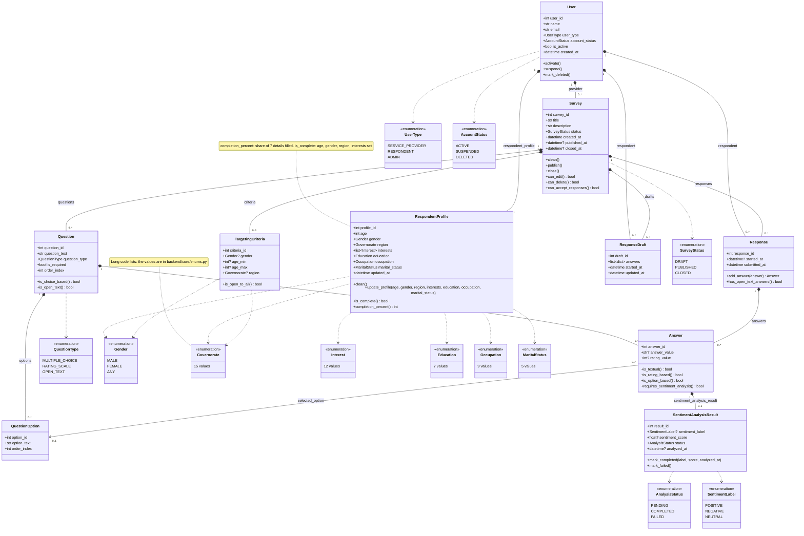

# Class diagram: domain model (Increment 1)

```
Basis: team convention (diagrams/README.md: requirement IDs and layer names)
Source of truth: backend/apps/core/models/ (ten model files), backend/core/enums.py
Date / version: 2026-11-13, develop commit d3d2db2
```

The ten domain classes of `apps.core`, their key attributes, the methods that hold business rules, and the
enumerations they use. Attribute types are the Python types of the Django fields.



## Business rules held by the classes

| Class | Method | Rule (from the code) |
|---|---|---|
| User | `activate`, `suspend`, `mark_deleted` | Set `account_status` and `is_active` together; delete is a soft delete. |
| RespondentProfile | `clean` | Only a RESPONDENT user may own a profile; `Gender.ANY` is not allowed. |
| RespondentProfile | `is_complete` | True when age, gender, a valid governorate and at least one interest are set. |
| RespondentProfile | `completion_percent` | Filled share of the seven `COMPLETION_FIELDS`, rounded, in percent. |
| Survey | `clean` | The provider must be a SERVICE_PROVIDER user. |
| Survey | `can_edit` | Only a DRAFT survey can be edited. |
| Survey | `can_delete` | Only a DRAFT or CLOSED survey can be deleted. |
| Survey | `can_accept_responses` | Only a PUBLISHED survey accepts responses. |
| TargetingCriteria | `is_open_to_all` | No gender (or ANY), no age limits and no region. |
| Answer | `requires_sentiment_analysis` | Only an answer to an OPEN_TEXT question is analysed. |
| SentimentAnalysisResult | `mark_completed`, `mark_failed` | COMPLETED stores label and score; FAILED clears them and stamps `analyzed_at`. |

## Legend

| Symbol | Meaning |
|---|---|
| Box with three parts | Class: name, attributes, methods. |
| Box marked `<<enumeration>>` | Enumeration (Django `TextChoices` in backend/core/enums.py). Short lists show every value; long lists show the number of values. |
| `+` | Public member. |
| `name()` and `name() type` | Method, with its return type when it returns a value. |
| `type?` | Optional attribute: the field allows NULL. |
| `list~T~` | List of T: `list~Interest~` is a PostgreSQL array, `list~dict~` is a JSON list. |
| Line with filled diamond (`*--`) | Composition: the part is deleted with the whole (`on_delete=CASCADE`). The diamond is on the whole. Team convention: a part with two CASCADE parents (Response, ResponseDraft, Answer) shows both. |
| Line with open arrow (`-->`) | Association: Answer knows its selected option; deleting the option sets the link to NULL (`on_delete=SET_NULL`). |
| Dashed arrow (`..>`) | Dependency: the attribute type is that enumeration. |
| `1`, `0..1`, `0..*` | Multiplicity at that end of the line. |
| Label on a line | The Django field or `related_name` that holds the link. |
| Note box | Comment attached to a class. |
