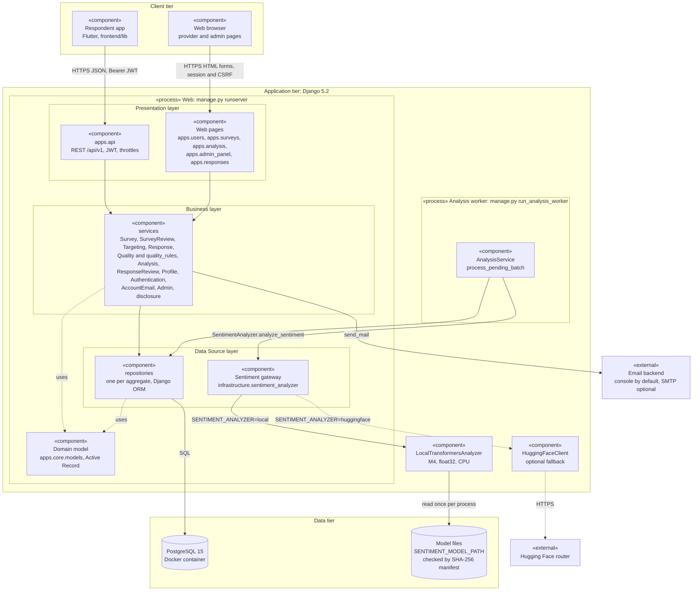

# Component diagram: tiers, layers and the analysis worker (Increment 2)

```
Basis: team convention (diagrams/README.md: tiers Client / Application / Data; layers Presentation / Business /
  Data Source, Fowler, Patterns of Enterprise Application Architecture, Ch. 1); UML 2.5 component notation drawn
  with a Mermaid flowchart (Mermaid has no component diagram type)
Source of truth: backend/config/urls.py and settings.py, backend/apps/ (seven Django apps), backend/services/,
  backend/repositories/, backend/infrastructure/ (sentiment_analyzer.py, local_analyzer.py, huggingface_analyzer.py,
  model_manifests/), backend/apps/core/management/commands/run_analysis_worker.py, frontend/lib/ (Flutter app),
  docker-compose.yml
Date / version: 2026-11-27, develop commit 59f1957
```

The deployed parts of the platform and the interfaces between them. Two processes run the same Django code: the web
process answers HTTP requests, and the analysis worker (T-9) labels open-text answers outside any request, so a
submit no longer waits for the model (K-02). The sentiment model runs on the laptop's CPU (FR-05, P-11); the
Hugging Face route is an optional fallback that is off by default. This diagram replaces the architecture slide of
Seminar 1 (Iteration 0), which shows Django 4.2 and the sentiment model as an external API behind `HuggingFaceClient`.



## Components

| Component | Layer or tier | Responsibility | Interface it offers or uses |
|---|---|---|---|
| Respondent app | Client | Respondent screens: register, log in, profile, survey list, answer with drafts and timings, answered surveys (FR-01, FR-02, FR-04, FR-06, FR-08). | Uses the REST API with JSON Web Tokens (planning/API.md). |
| Web browser | Client | Provider and admin pages; `/respondent/` only points respondents to the app (P-09). | Uses server-rendered HTML forms with a session cookie and CSRF token. |
| apps.api | Presentation | REST views, serializers, error mapping to one error shape, role permission, throttles (T-4, `survey_submit` 10/min). | Offers `/api/v1/`. |
| Web pages | Presentation | Django views and templates of the five web apps. | Offers `/users/`, `/surveys/`, `/analysis/`, `/admin-panel/`, `/respondent/`. |
| Domain model | Application (used by the layers) | The eleven model classes with the rules they hold (class-diagram.md); Active Record is a pattern, not a layer. | Used by services and repositories. |
| services | Business | Every business rule and every role check (FR-15 Part A); transactions. | Plain Python classes called by both presentation components and the worker. |
| repositories | Data Source | Queries and writes through the Django ORM; no rule beyond the query. | Used by services only. |
| Sentiment gateway | Data Source | `build_analyzer` picks the adapter named by `SENTIMENT_ANALYZER`; both adapters follow the `SentimentAnalyzer` protocol and raise typed errors (`config`, `payment_required`, `unavailable`, `bad_output`). | Offers `analyze_sentiment(text)` and `model_id`. |
| LocalTransformersAnalyzer | Data Source adapter | Checks every model file against the committed manifest, then loads M4 (clapAI/roberta-base-multilingual-sentiment) once per process; text cut at 512 tokens. | Reads the model folder. |
| HuggingFaceClient | Data Source adapter | Remote fallback; the router does not serve M4, so it runs another model. Off by default. | HTTPS to the Hugging Face router. |
| Analysis worker | Application, own process | Claims batches of PENDING rows, labels them, stores each outcome (state-sentiment-result.md). | Runs `AnalysisService.process_pending_batch` in a loop; `--check` labels three fixed sentences. |
| PostgreSQL | Data | The eleven domain tables (erd.md) and Django's own tables. | SQL over TCP (port 5432 in the container). |
| Email backend | External | Confirmation and password reset emails (FR-15). | Django `EMAIL_BACKEND`: console in development, SMTP from the environment. |

## Legend

| Symbol | Meaning |
|---|---|
| Box marked `«component»` | Component: a deployable or replaceable part with its responsibility. |
| Box marked `«external»` | A system outside the platform. |
| Box marked `«process»` | An operating-system process that runs the components inside it. |
| Cylinder | Data store. |
| Grey frame | Tier (Client, Application, Data) or layer (Presentation, Business, Data Source). |
| Solid arrow | Dependency: the source calls the interface named on the arrow. |
| Dashed arrow | Uses the domain model, or an optional dependency used only when the setting on the label is chosen. |
