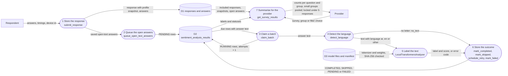

# Data-flow diagram: sentiment analysis pipeline (Increment 2)

```
Basis: D-055 (a data-flow diagram of the sentiment pipeline); Gane and Sarson symbols drawn with a Mermaid flowchart
Source of truth: backend/services/response_service.py (submit_response), backend/services/analysis_service.py
  (queue_open_text_answers, process_pending_batch, _analyse_claimed_result, get_survey_results and the summary
  helpers), backend/repositories/analysis_repository.py, backend/services/text_language.py,
  backend/infrastructure/local_analyzer.py, backend/services/disclosure.py
Date / version: 2026-11-27, develop commit 59f1957
```

How an open-text answer becomes a sentiment label and how the labels reach the provider (FR-05). Level 1: each
numbered process is one step of the code; the state changes of a result row are in state-sentiment-result.md.



## Processes

| No. | Process | Input | Output | Rule in the code |
|---|---|---|---|---|
| 1 | Store the response | The respondent's answers, timings and device id | The response with its profile snapshot and answers (D1) | One transaction with the evidence (FR-04) and the queueing of step 2. |
| 2 | Queue the open answers | Saved answers | One PENDING row per open-text answer that has text (D2) | Created in the same transaction as the answers, so no answer is lost and none is analysed twice. |
| 3 | Claim a batch | Due rows of D2 | Up to 8 RUNNING rows; a stale row with 3 attempts becomes FAILED | `select_for_update(skip_locked=True)`: two workers never take the same row. |
| 4 | Detect the language | The answer text | "ar" or "en" when at least half the letters are Arabic or Latin, otherwise "other"; none when the text has no letter | By the Unicode blocks of the letters; dialect is not detected (D-054). |
| 5 | Label the text | Text, model files | Label POSITIVE, NEUTRAL or NEGATIVE and a score, or a typed error | Model M4 chosen by T-2 (NFR-07); files refused unless every SHA-256 matches the committed manifest; 512 tokens at most. |
| 6 | Store the outcome | The label or the error | The row's new state in D2 | `unavailable` is retried after 30 s and 120 s, up to 3 attempts; other errors fail at once. |
| 7 | Summarise for the provider | Included responses and their snapshots (D1), labels (D2), the provider's choice | Counts per label for each open question, per demographic group with groups under 5 pooled (P-15), one filter at a time (FR-13) | Nothing is shown while the survey has fewer than 5 responses (P-20); excluded responses are left out (P-08); only the survey's owner (FR-15). |

## Legend

| Symbol | Meaning |
|---|---|
| Rectangle | External entity: a person outside the system. |
| Rounded box with a number | Process: transforms the data that enters it. |
| Cylinder with D and a number | Data store: a table or a set of files. |
| Arrow with a label | Data flow: the data that moves, in the direction of the arrow. |
