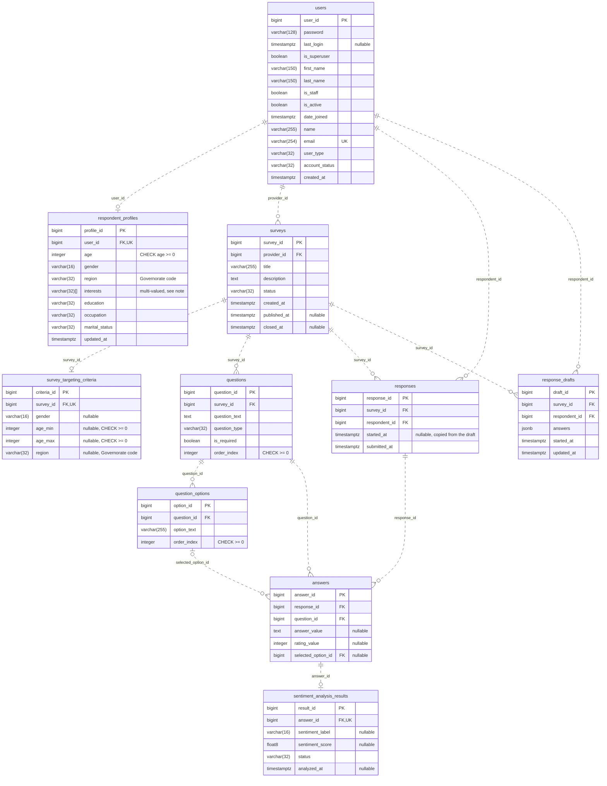

# ER diagram: relational schema (Increment 1)

```
Basis: team convention (diagrams/README.md: ERD with relational schema and constraints; Mermaid erDiagram, D-141)
Source of truth: backend/apps/core/models/ (ten model files), backend/apps/core/migrations/0001-0006
Date / version: 2026-11-13, develop commit d3d2db2
```

The ten tables of the domain model under their real `db_table` names, with PostgreSQL column types.
Django's own tables are left out: `auth_group`, `auth_permission`, `auth_group_permissions`, the user join tables
`users_groups` and `users_user_permissions`, `django_session`, `django_admin_log`, `django_content_type`,
`django_migrations` and the `token_blacklist_*` tables of Simple JWT.



**Note: multi-valued attribute.** `respondent_profiles.interests` is a PostgreSQL array (`ArrayField` of
`varchar(32)`, default empty list). One row holds zero or more Interest codes, so the column is a multi-valued
attribute and is not in first normal form. No join table exists for it.

**Note: delete rule.** On PostgreSQL, Django 5.2 creates every foreign key as `DEFERRABLE INITIALLY DEFERRED` without
an `ON DELETE` clause. The ORM performs the delete rules: `CASCADE` for every foreign key, except
`answers.selected_option_id`, which is `SET_NULL`.

## Constraints and indexes

| Table | Name | Kind | Columns | Purpose |
|---|---|---|---|---|
| responses | `unique_response_per_survey_respondent` | Composite unique (Meta, migration 0001) | survey_id, respondent_id | One response per respondent and survey (single-response rule; a parallel submit fails here). |
| response_drafts | `unique_draft_per_survey_respondent` | Composite unique (Meta, migration 0006) | survey_id, respondent_id | One draft per respondent and survey. |
| answers | `unique_answer_per_response_question` | Composite unique (Meta, migration 0002) | response_id, question_id | One answer per question in a response. |
| users | (Django name) | Unique (`unique=True`) | email | The email is the login name. |
| respondent_profiles | (Django name) | Unique (`OneToOneField`) | user_id | At most one profile per user. |
| survey_targeting_criteria | (Django name) | Unique (`OneToOneField`) | survey_id | At most one criteria row per survey. |
| sentiment_analysis_results | (Django name) | Unique (`OneToOneField`) | answer_id | At most one result per answer. |
| respondent_profiles | (Django name) | Check (`PositiveIntegerField`) | age | `age >= 0`; the range 1 to 120 is a service rule. |
| survey_targeting_criteria | (Django name) | Check (`PositiveIntegerField`) | age_min, age_max | Each `>= 0` when set. |
| questions | (Django name) | Check (`PositiveIntegerField`) | order_index | `order_index >= 0`. |
| question_options | (Django name) | Check (`PositiveIntegerField`) | order_index | `order_index >= 0`. |
| users | `users_created_at_idx` | Index (Meta, migration 0002) | created_at | Admin lists and counts by date. |
| users | `users_user_type_idx` | Index (Meta, migration 0002) | user_type | Filter accounts by role. |
| users | `users_account_status_idx` | Index (Meta, migration 0002) | account_status | Filter accounts by status. |
| surveys | `surveys_status_idx` | Index (Meta, migration 0002) | status | Filter surveys by state. |
| surveys | `surveys_status_pub_idx` | Index (Meta, migration 0002) | status, published_at | Published surveys in publish order. |
| responses | `responses_sub_at_idx` | Index (Meta, migration 0002) | submitted_at | Responses by date. |
| responses | `responses_resp_sub_idx` | Index (Meta, migration 0002) | respondent_id, submitted_at | Answered surveys of one respondent, newest first. |
| answers | `answers_q_opt_idx` | Index (Meta, migration 0002) | question_id, selected_option_id | Count choices per option. |
| answers | `answers_q_rating_idx` | Index (Meta, migration 0002) | question_id, rating_value | Rating distribution per question. |
| sentiment_analysis_results | `sent_results_status_idx` | Index (Meta, migration 0002) | status | Find PENDING or FAILED results. |
| every table with a foreign key | (Django names) | Index (Django default for `ForeignKey`) | each FK column that is not one-to-one | Joins and the ORM delete rules. |

No model or migration declares a `CheckConstraint`. The check constraints above are the ones Django generates for
`PositiveIntegerField` columns. Allowed code values (for example `status`, `region`) are checked by Django choices and
the services, not by the database.

## Legend

| Symbol | Meaning |
|---|---|
| Box | Table, under its real `db_table` name. |
| Row in a box | Column: PostgreSQL type, column name, key marker, comment. |
| `PK` | Primary key (`bigint`, generated by `BigAutoField`). |
| `FK` | Foreign key to the table on the other end of the line. |
| `UK` | Unique column. `FK, UK` is a one-to-one link. |
| Quoted text after a column | Comment: nullable, check, or meaning of the value. |
| `varchar(32)[]` | PostgreSQL array: a multi-valued attribute. |
| `\|\|` at a line end | Exactly one. |
| `\|o` at a line end | Zero or one. |
| `o{` at a line end | Zero or many (crow's foot). |
| Dashed line | Non-identifying relationship: the child has its own surrogate key, the link is a foreign key. |
| Label on a line | The foreign key column that holds the link. |
