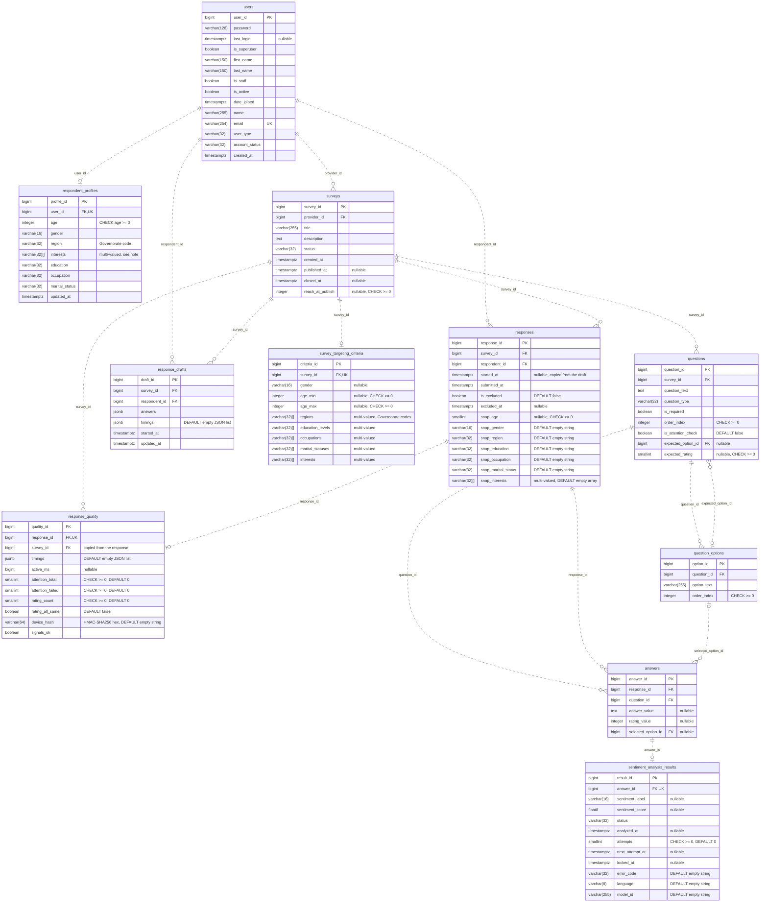

# ER diagram: relational schema (Increment 2)

```
Basis: team convention (diagrams/README.md: ERD with relational schema and constraints; Mermaid erDiagram, D-141)
Source of truth: backend/apps/core/models/ (eleven model files), backend/apps/core/migrations/0001-0013
  (0007 sentiment worker fields, 0008-0010 targeting lists, 0011 reach at publish, 0012 FR-04 evidence fields,
  0013 FR-04 snapshot fill)
Date / version: 2026-11-20, develop commit f3c96d4
```

The eleven tables of the domain model under their real `db_table` names, with PostgreSQL column types.
Django's own tables are left out: `auth_group`, `auth_permission`, `auth_group_permissions`, the user join tables
`users_groups` and `users_user_permissions`, `django_session`, `django_admin_log`, `django_content_type`,
`django_migrations` and the `token_blacklist_*` tables of Simple JWT. Migrations 0009 and 0013 change data only.



**Note: multi-valued attributes.** `respondent_profiles.interests`, the five lists of `survey_targeting_criteria`
(`regions`, `education_levels`, `occupations`, `marital_statuses`, `interests`) and `responses.snap_interests` are
PostgreSQL arrays (`ArrayField` of `varchar(32)`, default empty list). One row holds zero or more codes, so each such
column is a multi-valued attribute and is not in first normal form. No join table exists for them. An empty
targeting list means no restriction on that detail.

**Note: database defaults.** A comment `DEFAULT ...` marks a column with `db_default` (migrations 0007 and 0012):
PostgreSQL itself fills the value when an insert does not name the column, so rows written before the column existed
and inserts that leave it out stay valid. The other defaults (for example the empty targeting lists) are set by
Django only.

**Note: delete rule.** On PostgreSQL, Django 5.2 creates every foreign key as `DEFERRABLE INITIALLY DEFERRED` without
an `ON DELETE` clause. The ORM performs the delete rules: `CASCADE` for every foreign key, except
`answers.selected_option_id` and `questions.expected_option_id`, which are `SET_NULL`.

**Note: no stored verdict.** `response_quality` (model `ResponseQuality`, one row per response) holds evidence only. No table stores a quality flag, score or band:
they are derived on read (P-01). The include or exclude decision is `responses.is_excluded` and `excluded_at`.

## Constraints and indexes

| Table | Name | Kind | Columns | Purpose |
|---|---|---|---|---|
| responses | `unique_response_per_survey_respondent` | Composite unique (Meta, migration 0001) | survey_id, respondent_id | One response per respondent and survey (single-response rule; a parallel submit fails here). |
| response_drafts | `unique_draft_per_survey_respondent` | Composite unique (Meta, migration 0006) | survey_id, respondent_id | One draft per respondent and survey. |
| answers | `unique_answer_per_response_question` | Composite unique (Meta, migration 0002) | response_id, question_id | One answer per question in a response. |
| users | (Django name) | Unique (`unique=True`) | email | The email is the login name. |
| respondent_profiles | (Django name) | Unique (`OneToOneField`) | user_id | At most one profile per user. |
| survey_targeting_criteria | (Django name) | Unique (`OneToOneField`) | survey_id | At most one criteria row per survey. |
| sentiment_analysis_results | (Django name) | Unique (`OneToOneField`) | answer_id | At most one result per answer. |
| response_quality | (Django name) | Unique (`OneToOneField`, migration 0012) | response_id | At most one evidence row per response. |
| respondent_profiles | (Django name) | Check (`PositiveIntegerField`) | age | `age >= 0`; the range 1 to 120 is a service rule. |
| surveys | (Django name) | Check (`PositiveIntegerField`, migration 0011) | reach_at_publish | `>= 0` when set. |
| survey_targeting_criteria | (Django name) | Check (`PositiveIntegerField`) | age_min, age_max | Each `>= 0` when set. |
| questions | (Django name) | Check (`PositiveIntegerField`) | order_index | `order_index >= 0`. |
| questions | (Django name) | Check (`PositiveSmallIntegerField`, migration 0012) | expected_rating | `>= 0` when set; the range 1 to 5 is a service rule. |
| question_options | (Django name) | Check (`PositiveIntegerField`) | order_index | `order_index >= 0`. |
| responses | (Django name) | Check (`PositiveSmallIntegerField`, migration 0012) | snap_age | `>= 0` when set. |
| response_quality | (Django name) | Check (`PositiveSmallIntegerField`, migration 0012) | attention_total, attention_failed, rating_count | Each `>= 0`. |
| sentiment_analysis_results | (Django name) | Check (`PositiveSmallIntegerField`, migration 0007) | attempts | `attempts >= 0`. |
| users | `users_created_at_idx` | Index (Meta, migration 0002) | created_at | Admin lists and counts by date. |
| users | `users_user_type_idx` | Index (Meta, migration 0002) | user_type | Filter accounts by role. |
| users | `users_account_status_idx` | Index (Meta, migration 0002) | account_status | Filter accounts by status. |
| surveys | `surveys_status_idx` | Index (Meta, migration 0002) | status | Filter surveys by state. |
| surveys | `surveys_status_pub_idx` | Index (Meta, migration 0002) | status, published_at | Published surveys in publish order. |
| responses | `responses_sub_at_idx` | Index (Meta, migration 0002) | submitted_at | Responses by date. |
| responses | `responses_resp_sub_idx` | Index (Meta, migration 0002) | respondent_id, submitted_at | Answered surveys of one respondent, newest first. |
| answers | `answers_q_opt_idx` | Index (Meta, migration 0002) | question_id, selected_option_id | Count choices per option. |
| answers | `answers_q_rating_idx` | Index (Meta, migration 0002) | question_id, rating_value | Rating distribution per question. |
| sentiment_analysis_results | `sent_results_status_idx` | Index (Meta, migration 0002) | status | Find PENDING, RUNNING or FAILED results. |
| response_quality | `resp_quality_device_idx` | Index (Meta, migration 0012) | survey_id, device_hash | Same-device comparison within one survey. |
| every table with a foreign key | (Django names) | Index (Django default for `ForeignKey`) | each FK column that is not one-to-one | Joins and the ORM delete rules. |

No model or migration declares a `CheckConstraint`. The check constraints above are the ones Django generates for
`PositiveIntegerField` and `PositiveSmallIntegerField` columns. Allowed code values (for example `status`, `region`,
the targeting lists) are checked by Django choices and the services, not by the database; the `snap_` columns have no
choices, so a later change of a code list never rewrites a stored snapshot.

## Legend

| Symbol | Meaning |
|---|---|
| Box | Table, under its real `db_table` name. |
| Row in a box | Column: PostgreSQL type, column name, key marker, comment. |
| `PK` | Primary key (`bigint`, generated by `BigAutoField`). |
| `FK` | Foreign key to the table on the other end of the line. |
| `UK` | Unique column. `FK, UK` is a one-to-one link. |
| Quoted text after a column | Comment: nullable, check, database default, or meaning of the value. |
| `DEFAULT ...` in a comment | Database default from `db_default`; see the note. |
| `varchar(32)[]` | PostgreSQL array: a multi-valued attribute. |
| `\|\|` at a line end | Exactly one. |
| `\|o` at a line end | Zero or one. |
| `o{` at a line end | Zero or many (crow's foot). |
| Dashed line | Non-identifying relationship: the child has its own surrogate key, the link is a foreign key. |
| Label on a line | The foreign key column that holds the link. |
