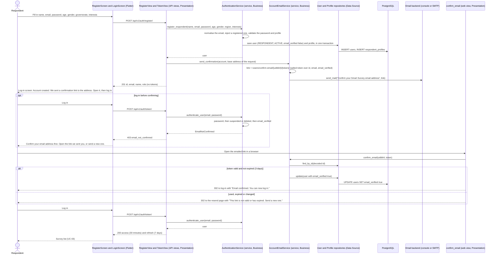

# Sequence diagram: UC-01 Register as respondent, with email confirmation (FR-01, FR-15)

```
Basis: team convention; diagrams/README.md (layers Presentation / Business / Data Source)
Source of truth: frontend/lib/features/auth/register_screen.dart, frontend/lib/features/auth/login_screen.dart,
  frontend/lib/features/auth/auth_repository.dart, backend/apps/api/views.py (RegisterView, TokenView),
  backend/apps/api/exceptions.py, backend/apps/users/views.py (confirm_email), backend/services/
  authentication_service.py (register_respondent, authenticate_user), backend/services/account_email_service.py
  (send_confirmation, confirm_email, EmailConfirmationTokenGenerator), backend/repositories/user_repository.py,
  backend/config/settings.py (EMAIL_BACKEND)
Date / version: 2026-11-27, develop commit 59f1957
```

A person registers in the app. The account is created unconfirmed and a confirmation link is emailed (printed in the
server window in development). Log-in is refused until the link is opened on the website. UC-07 (a provider registers
on the website) follows the same server steps from `apps/users/views.py`.



The confirmation token stops working once it is used, because `email_verified` is part of the signed value; no table
of codes exists. A wrong password gives 401 "Invalid email or password." before the confirmation is checked, so only
the account's owner learns that the address is unconfirmed. Accounts made by the team's commands and every account
that existed before migration 0017 are confirmed by default.

## Legend

| Symbol | Meaning |
|---|---|
| Stick figure | Actor: the person registering. |
| Box at the top | Lifeline: one object or group of objects; the label names it and its layer. |
| Solid arrow (`->>`) | Call, HTTP request or email sent. |
| Dashed arrow (`-->>`) | Return value or HTTP response with its status code. |
| Arrow back to the same lifeline | Internal step of that object. |
| `alt` / `else` frame | Alternatives: only one branch runs, chosen by the condition. |
| `opt` frame | Optional part: runs only when the person tries it. |
| `200`, `201`, `302`, `403` | HTTP status codes. |
