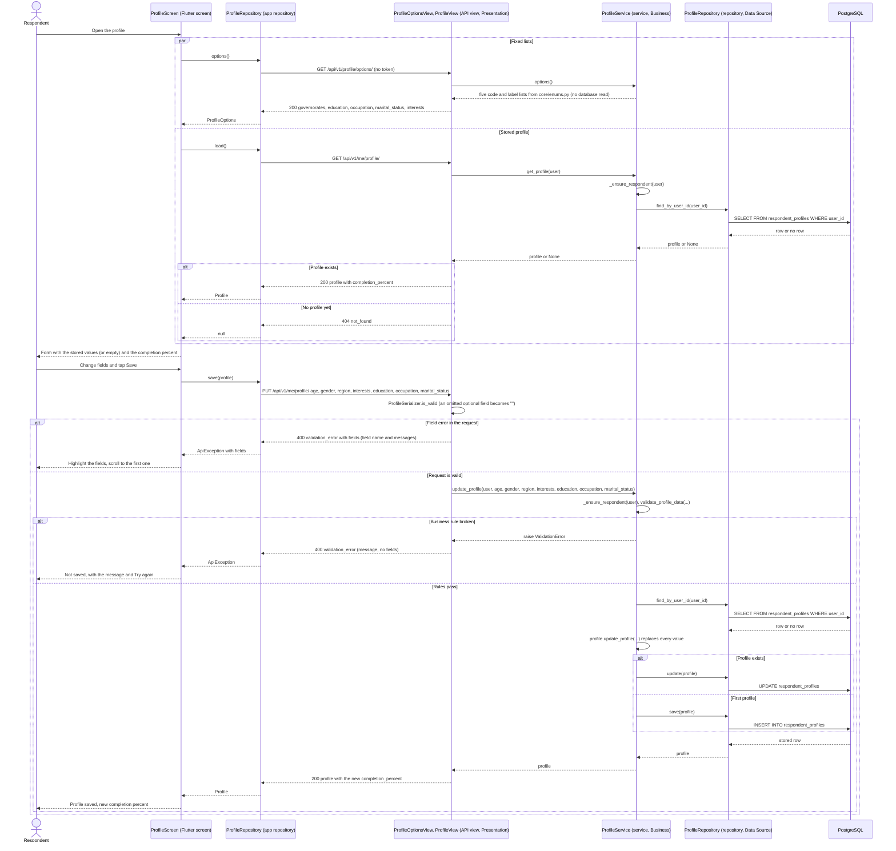

# Sequence diagram: UC-02 Manage demographic profile (FR-02)

```
Basis: team convention; diagrams/README.md (layers Presentation / Business / Data Source)
Source of truth: frontend/lib/features/profile/profile_screen.dart, frontend/lib/features/profile/profile_repository.dart,
  backend/apps/api/urls.py, backend/apps/api/views.py (ProfileOptionsView, ProfileView), backend/apps/api/serializers.py
  (ProfileSerializer), backend/apps/api/exceptions.py, backend/services/profile_service.py,
  backend/repositories/profile_repository.py, backend/apps/core/models/respondent_profile.py
Date / version: 2026-11-13, develop commit d3d2db2
```

The respondent opens the profile, the app loads the fixed lists and the stored profile in parallel, and Save sends the
whole profile with PUT (full replace). Every request carries the access token except the public options request.



Full replace: the view passes `""` for an omitted optional field, so PUT clears education, occupation or marital
status when the app leaves them out. A user who is not a respondent gets 403 `unauthorized_action` from
`_ensure_respondent`; the app has only respondent accounts, so that path is not drawn.

## Legend

| Symbol | Meaning |
|---|---|
| Stick figure | Actor: the person using the app. |
| Box at the top | Lifeline: one object or group of classes; the label names the class and its layer. |
| Solid arrow (`->>`) | Call or HTTP request. |
| Dashed arrow (`-->>`) | Return value or HTTP response with its status code. |
| Arrow back to the same lifeline | Internal step of that object. |
| `par` / `and` frame | The parts run at the same time (`Future.wait` in the app). |
| `alt` / `else` frame | Alternatives: only one branch runs, chosen by the condition in brackets. |
| `400`, `404`, `200` | HTTP status code; the word after it is the `error.code` of the shared error body. |
