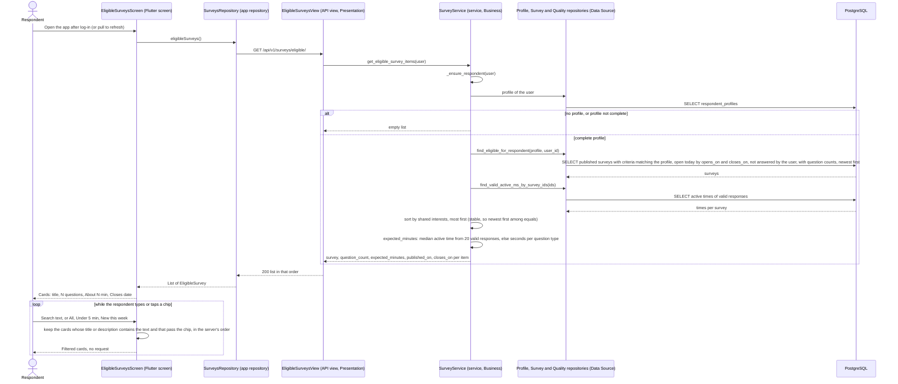

# Sequence diagram: UC-03 Browse matching surveys (FR-01, FR-03, FR-08, FR-11)

```
Basis: team convention; diagrams/README.md (layers Presentation / Business / Data Source)
Source of truth: frontend/lib/features/surveys/eligible_surveys_screen.dart, frontend/lib/features/surveys/
  surveys_repository.dart, backend/apps/api/views.py (EligibleSurveysView), backend/services/survey_service.py
  (get_eligible_survey_items), backend/services/expected_time.py (expected_minutes),
  backend/repositories/survey_repository.py (find_eligible_for_respondent), backend/repositories/profile_repository.py,
  backend/repositories/quality_repository.py (find_valid_active_ms_by_survey_ids)
Date / version: 2026-11-27, develop commit 59f1957
```

The respondent sees the published surveys that match his profile and are open today, ranked by the interests they
share with him, each with its question count, expected time and closing date. Search and the three chips filter the
list inside the app; they send no request.



A paused survey, a survey before its opening date and a survey after its closing date are not in the list, because the
query keeps PUBLISHED surveys that are open today (state-survey-lifecycle.md). The matching rule is the same as the
reach count of UC-10; a parity test keeps the forms equal (P-18).

## Legend

| Symbol | Meaning |
|---|---|
| Stick figure | Actor: the person using the app. |
| Box at the top | Lifeline: one object or group of objects; the label names it and its layer. |
| Solid arrow (`->>`) | Call or HTTP request. |
| Dashed arrow (`-->>`) | Return value or HTTP response with its status code. |
| Arrow back to the same lifeline | Internal step of that object. |
| `alt` / `else` frame | Alternatives: only one branch runs, chosen by the condition. |
| `loop` frame | Repeated while the condition holds. |
| `200` | HTTP status code. |
