# Sequence diagram: UC-04 Answer a survey, with draft, resume and quality evidence (FR-06, FR-04) (Increment 2)

```
Basis: team convention; diagrams/README.md (layers Presentation / Business / Data Source)
Source of truth: frontend/lib/features/answer/survey_start_screen.dart, frontend/lib/features/answer/survey_answer_screen.dart,
  frontend/lib/features/answer/answer_repository.dart, frontend/lib/features/answer/active_time.dart,
  frontend/lib/features/answer/answer_models.dart (SurveyDraft.keptFor), frontend/lib/core/device_id_store.dart,
  backend/apps/api/views.py (SurveyDetailView, DraftView, SubmitResponseView), backend/services/question_service.py
  (get_response_form), backend/services/response_service.py, backend/services/quality_service.py (clean_timings,
  clean_device_id, capture), backend/services/analysis_service.py (queue_open_text_answers, process_pending_batch),
  backend/repositories/analysis_repository.py (create_pending, claim_batch),
  backend/apps/core/management/commands/run_analysis_worker.py
Date / version: 2026-11-20, develop commit f3c96d4
```

The start screen loads the survey and the draft. When no draft exists, the answer screen saves an empty draft first:
the start mark, which makes the server set `started_at`. The app counts active time per question and sends it with
every draft save and with the submit, together with its install ID. Send stores the response, the answers, the
quality evidence and the PENDING sentiment rows in one transaction. The analysis worker reads the PENDING rows later,
outside the request (T-9).

```mermaid
sequenceDiagram
    actor R as Respondent
    participant SS as SurveyStartScreen (Flutter screen)
    participant AS as SurveyAnswerScreen (Flutter screen)
    participant AR as AnswerRepository (app repository)
    participant DI as SecureDeviceIdStore (app storage)
    participant V as SurveyDetailView, DraftView, SubmitResponseView (API view, Presentation)
    participant QS as QuestionService (service, Business)
    participant RS as ResponseService (service, Business)
    participant QL as QualityService (service, Business)
    participant AN as AnalysisService (service, Business)
    participant W as run_analysis_worker (management command, Presentation)
    participant DR as Survey, Question, Profile, Draft, Response, Quality, Analysis repositories (repository, Data Source)
    participant DB as PostgreSQL

    R->>SS: Open a survey from the eligible list
    par Survey
        SS->>AR: survey(id)
        AR->>V: GET /api/v1/surveys/{id}/
        V->>QS: get_response_form(user, id)
        QS->>RS: ensure_can_answer(user, id)
        RS->>DR: SurveyRepository.find_by_id, ResponseRepository.has_response_for_survey
        DR->>DB: SELECT FROM surveys, responses
        RS->>RS: respondent, survey exists, can_accept_responses, targeting match, not answered yet
        RS-->>QS: survey
        QS->>DR: QuestionRepository.find_by_survey_id_with_options(id)
        DR->>DB: SELECT questions, question_options
        DR-->>QS: questions with options
        QS-->>V: survey and questions in order_index order
        V-->>AR: 200 survey detail
        AR-->>SS: SurveyDetail
    and Draft
        SS->>AR: draft(id)
        AR->>V: GET /api/v1/surveys/{id}/draft/
        V->>RS: get_draft(user, id)
        RS->>RS: ensure_can_answer(user, id)
        RS->>DR: DraftRepository.find(survey_id, respondent_id)
        DR->>DB: SELECT FROM response_drafts
        DB-->>DR: row or no row
        alt Draft exists
            RS-->>V: draft
            V-->>AR: 200 survey_id, answers, timings, started_at, updated_at
            AR-->>SS: SurveyDraft
        else No draft
            RS-->>V: raise DraftNotFound
            V-->>AR: 404 draft_not_found
            AR-->>SS: null
        end
    end

    alt Draft with answers the survey still accepts (keptFor)
        SS-->>R: Continue or Start over
        alt Continue (resume)
            R->>SS: Continue
            SS->>AS: open at the first unanswered question with the draft's timings, draftExists true
        else Start over
            R->>SS: Start over and confirm
            SS->>AR: deleteDraft(id)
            AR->>V: DELETE /api/v1/surveys/{id}/draft/
            V->>RS: delete_draft(user, id)
            RS->>DR: DraftRepository.delete(survey_id, respondent_id)
            DR->>DB: DELETE FROM response_drafts
            V-->>AR: 204
            SS->>AS: open at question 1, draftExists false
        end
    else No draft, or a draft with only the start mark
        R->>SS: Start survey
        SS->>AS: open at question 1, draftExists true only when the server holds a draft
    end

    opt Start mark, when the server holds no draft (draftExists false)
        AS->>AR: saveDraft(id, no answers, no timings)
        AR->>V: PUT /api/v1/surveys/{id}/draft/ with empty answers and timings lists
        V->>RS: save_draft(user, id, answers, timings)
        RS->>RS: ensure_can_answer(user, id)
        RS->>DR: DraftRepository.find, then save(new ResponseDraft)
        DR->>DB: INSERT INTO response_drafts, started_at set by the server
        V-->>AR: 200 draft
    end
    AS->>AS: ActiveTimeTracker.show(question), counts only while shown and in the foreground

    loop Each move to another question (Next, Skip or Back)
        R->>AS: Answer and move
        AS->>AS: ActiveTimeTracker.show(next question), snapshot()
        opt Answers or timings differ from the last saved ones
            AS->>AR: saveDraft(id, answers, timings)
            AR->>V: PUT /api/v1/surveys/{id}/draft/ answers, timings (full replace)
            V->>RS: save_draft(user, id, answers, timings)
            RS->>RS: ensure_can_answer, check each answer (nothing required yet)
            RS->>QL: clean_timings(timings, question ids)
            QL-->>RS: timings, or raise ValidationError
            RS->>DR: DraftRepository.find, then save(draft) with answers and timings
            DR->>DB: UPDATE response_drafts
            DB-->>DR: stored row
            V-->>AR: 200 draft
        end
    end

    opt Respondent leaves before sending
        R->>AS: Leave survey
        AS->>AS: ActiveTimeTracker.hide()
        AS->>AR: saveDraft(id, answers, timings) with the last values
        AR->>V: PUT /api/v1/surveys/{id}/draft/
        V-->>AR: 200 draft
        AS-->>SS: close, the start screen loads the survey and the draft again
        Note over R,SS: Later the respondent opens the survey again and resumes with Continue
    end

    R->>AS: Send answers on the review page
    AS->>AS: ActiveTimeTracker.hide(), snapshot()
    AS->>AR: submit(id, answers, timings)
    AR->>DI: readOrCreate()
    DI-->>AR: install ID, or no ID when the store fails
    AR->>V: POST /api/v1/surveys/{id}/responses/ answers, timings, device_id
    V->>RS: submit_response(user, id, answers, timings, device_id)
    RS->>RS: ensure_can_answer(user, id)
    RS->>DR: ResponseRepository.has_response_for_survey(survey_id, respondent_id)
    DR->>DB: SELECT EXISTS FROM responses
    alt Already answered
        RS-->>V: raise DuplicateResponse
        V-->>AR: 409 duplicate_response
        AR-->>AS: ApiException
        AS-->>R: You already answered this survey (after a lost connection the app shows the sent screen)
    else Not answered yet
        RS->>RS: check required answers and each answer against its question type
        RS->>QL: clean_timings(timings, question ids) when sent, clean_device_id(device_id)
        alt Answer, timing or device ID invalid
            RS-->>V: raise ValidationError
            V-->>AR: 400 validation_error
            AS-->>R: Mark the questions that need an answer
        else All valid
            critical transaction.atomic
                RS->>DR: DraftRepository.find(survey_id, respondent_id)
                DR->>DB: SELECT FROM response_drafts
                RS->>DR: ProfileRepository.find_by_user_id(respondent_id)
                DR->>DB: SELECT FROM respondent_profiles
                RS->>DR: ResponseRepository.save(Response with started_at = draft.started_at and the snap_ fields)
                DR->>DB: INSERT INTO responses
                loop Each answer with a value
                    RS->>DR: ResponseRepository.save_answer(answer)
                    DR->>DB: INSERT INTO answers
                end
                alt The submit carries timings
                    RS->>RS: the submit's own timings count
                else No timings in the submit
                    RS->>RS: the draft's last saved timings count, none without a draft
                end
                RS->>QL: capture(response, questions, answers, timings, device_id, draft.started_at)
                QL->>QL: active_ms, attention_total, attention_failed, rating_count, rating_all_same
                QL->>QL: device_hash = HMAC-SHA256 of device_id with DEVICE_HASH_KEY
                QL->>QL: signals_ok = timings, device_id and started_at present and active_ms within the wall time plus 10 s
                QL->>DR: QualityRepository.save(ResponseQuality)
                DR->>DB: INSERT INTO response_quality
                RS->>AN: queue_open_text_answers(saved answers)
                AN->>DR: AnalysisRepository.create_pending(open-text answers with text)
                DR->>DB: INSERT INTO sentiment_analysis_results, status PENDING
                RS->>DR: DraftRepository.delete(survey_id, respondent_id)
                DR->>DB: DELETE FROM response_drafts
                DB-->>RS: COMMIT
            option Parallel submit hits unique_response_per_survey_respondent
                DB-->>RS: IntegrityError, ROLLBACK
                RS-->>V: raise DuplicateResponse
                V-->>AR: 409 duplicate_response
            end
            RS-->>V: response
            V-->>AR: 201 id, survey_id, submitted_at
            AR-->>AS: SubmitResult
            AS-->>R: Sent screen
        end
    end

    loop Later, in its own process: each batch of the analysis worker
        W->>AN: process_pending_batch(limit)
        AN->>DR: AnalysisRepository.claim_batch
        DR->>DB: SELECT due PENDING and stale RUNNING rows FOR UPDATE SKIP LOCKED, UPDATE them to RUNNING
        DR-->>AN: claimed results
        AN->>AN: analyse each text, then mark_completed, mark_skipped, mark_failed or schedule_retry
        AN->>DR: AnalysisRepository.update(result)
        DR->>DB: UPDATE sentiment_analysis_results
    end
```



Notes from the code:

- `ensure_can_answer` checks, in order: respondent (403 `unauthorized_action`), survey exists (404 `survey_not_found`),
  published (409 `not_editable`), targeting match (403 `unauthorized_action`), not answered yet (409
  `duplicate_response`). The survey detail request and the three draft requests run all five checks.
- The answer screen sends at most one draft request at a time; newer answers and timings wait and follow it. It also
  saves when the app is hidden (best effort). A failed save that lost only timings is not an error: they go again
  with the next save.
- Active time (`ActiveTimeTracker`) counts only while a question is on screen and the app is in the foreground, over
  every visit, never on the review page; each value is at most 3,600,000 ms.
- The install ID is 128 random bits kept in the platform keystore; logout does not delete it. The server stores only
  its keyed hash in `response_quality.device_hash`, never the raw ID.
- Missing or inconsistent evidence never rejects a response: it only sets `signals_ok` to false. A malformed timing or
  device ID is a 400; a timing for a question of another survey raises `QuestionNotFound`.
- The draft's `started_at` is set by the first save, which is the start mark when the app opens a survey with no
  draft; `capture` compares the active time with the wall time from that start to the submit.
- The worker's analysis call goes to the analyzer built by `infrastructure/sentiment_analyzer.build_analyzer`; the
  submit request makes no analysis call and never waits for one.

## Legend

| Symbol | Meaning |
|---|---|
| Stick figure | Actor: the person using the app. |
| Box at the top | Lifeline: one object or group of classes; the label names the class and its layer. |
| Solid arrow (`->>`) | Call or HTTP request. |
| Dashed arrow (`-->>`) | Return value, raised exception or HTTP response with its status code. |
| Arrow back to the same lifeline | Internal step of that object. |
| `par` / `and` frame | The parts run at the same time (`Future.wait` in the app). |
| `alt` / `else` frame | Alternatives: only one branch runs, chosen by the condition in brackets. |
| `opt` frame | Optional part: runs only when the condition holds. |
| `loop` frame | Repeated part. |
| `critical` / `option` frame | Database transaction (`transaction.atomic`): all steps commit together; the `option` part is the failure that rolls everything back. |
| Note | Comment over the lifelines it names. |
| `200`, `201`, `204`, `400`, `404`, `409` | HTTP status code; the word after it is the `error.code` of the shared error body. |
