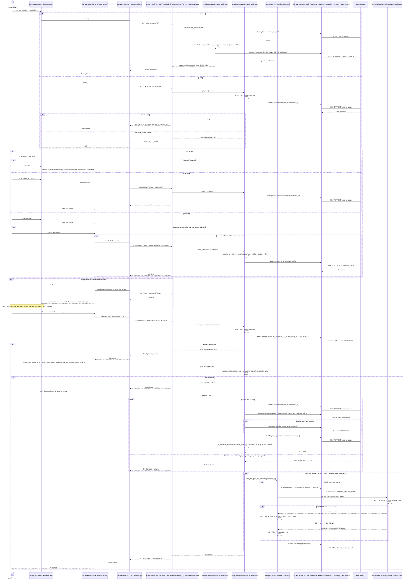

# Sequence diagram: UC-04 Answer a survey, with draft and resume (FR-06)

```
Basis: team convention; diagrams/README.md (layers Presentation / Business / Data Source); planning/API.md (known limit K-02)
Source of truth: frontend/lib/features/answer/survey_start_screen.dart, frontend/lib/features/answer/survey_answer_screen.dart,
  frontend/lib/features/answer/answer_repository.dart, backend/apps/api/urls.py, backend/apps/api/views.py
  (SurveyDetailView, DraftView, SubmitResponseView), backend/apps/api/exceptions.py, backend/services/question_service.py,
  backend/services/response_service.py, backend/services/analysis_service.py, backend/repositories/ (survey, question,
  draft, response, analysis), backend/infrastructure/huggingface_client.py, backend/config/settings.py (CELERY_ENABLED)
Date / version: 2026-11-13, develop commit d3d2db2
```

The start screen loads the survey and the draft, the answer screen saves the draft each time the respondent moves to
another question, and Send stores the response in one transaction. Sentiment analysis then runs inside the same
request, after the commit (K-02, today's behaviour; `USE_CELERY` is false by default).



Notes from the code:

- `ensure_can_answer` checks, in order: respondent (403 `unauthorized_action`), survey exists (404 `survey_not_found`),
  published (409 `not_editable`), targeting match (403 `unauthorized_action`), not answered yet (409
  `duplicate_response`). The draft requests run all five checks. The survey detail request runs the first four only
  (`QuestionService._ensure_respondent_can_answer`).
- The answer screen sends at most one draft request at a time; newer answers wait and follow it.
- The on-commit callback is registered with `robust=True`: an error inside the analysis is logged and the response
  stays stored. A Hugging Face failure never changes the 201 answer; it only stores FAILED.
- With `USE_CELERY=true` the callback sends the work to a Celery task instead and the request does not wait. This is
  not the default and is not drawn.

## Legend

| Symbol | Meaning |
|---|---|
| Stick figure | Actor: the person using the app. |
| Box at the top | Lifeline: one object or group of classes; the label names the class and its layer. |
| Solid arrow (`->>`) | Call or HTTP request. |
| Dashed arrow (`-->>`) | Return value, raised exception or HTTP response with its status code. |
| Arrow back to the same lifeline | Internal step of that object. |
| `par` / `and` frame | The parts run at the same time (`Future.wait` in the app). |
| `alt` / `else` frame | Alternatives: only one branch runs, chosen by the condition in brackets. |
| `opt` frame | Optional part: runs only when the condition holds. |
| `loop` frame | Repeated part. |
| `critical` / `option` frame | Database transaction (`transaction.atomic`): all steps commit together; the `option` part is the failure that rolls everything back. |
| Note | Comment over the lifelines it names. |
| `200`, `201`, `204`, `400`, `404`, `409` | HTTP status code; the word after it is the `error.code` of the shared error body. |
| HTTP 402 | Status code returned by Hugging Face (payment required) when the account cannot run the model. |
