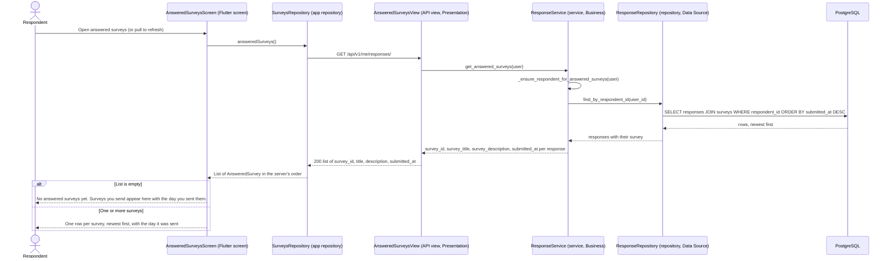

# Sequence diagram: UC-06 View answered surveys (FR-01)

```
Basis: team convention; diagrams/README.md (layers Presentation / Business / Data Source)
Source of truth: frontend/lib/features/surveys/answered_surveys_screen.dart, frontend/lib/features/surveys/surveys_repository.dart,
  backend/apps/api/urls.py, backend/apps/api/views.py (AnsweredSurveysView), backend/apps/api/serializers.py
  (AnsweredSurveySerializer), backend/services/response_service.py (get_answered_surveys),
  backend/repositories/response_repository.py (find_by_respondent_id)
Date / version: 2026-11-13, develop commit d3d2db2
```

The respondent opens the list of surveys already sent. The server returns them newest first; the app keeps that order.
The list is read-only: an answered survey cannot be sent again.



A user who is not a respondent gets 403 `unauthorized_action` from `_ensure_respondent_for_answered_surveys`; the app
has only respondent accounts, so that path is not drawn. The index `responses_resp_sub_idx`
(respondent_id, submitted_at) matches this query, see erd.md.

## Legend

| Symbol | Meaning |
|---|---|
| Stick figure | Actor: the person using the app. |
| Box at the top | Lifeline: one object; the label names the class and its layer. |
| Solid arrow (`->>`) | Call or HTTP request. |
| Dashed arrow (`-->>`) | Return value or HTTP response with its status code. |
| Arrow back to the same lifeline | Internal step of that object. |
| `alt` / `else` frame | Alternatives: only one branch runs, chosen by the condition in brackets. |
| `200` | HTTP status code. |
