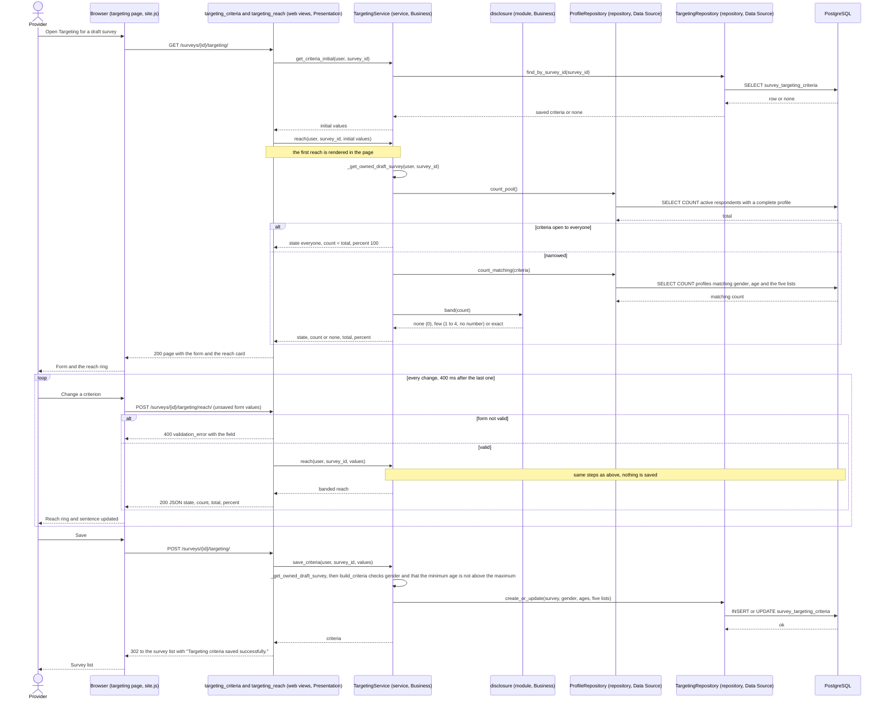

# Sequence diagram: UC-10 Define targeting and preview reach (FR-03)

```
Basis: team convention; diagrams/README.md (layers Presentation / Business / Data Source)
Source of truth: backend/apps/surveys/views.py (targeting_criteria, targeting_reach), backend/static/js/site.js (W-03
  reach card), backend/services/targeting_service.py (reach, describe_reach, save_criteria, build_criteria),
  backend/services/disclosure.py (band), backend/repositories/profile_repository.py (count_pool, count_matching),
  backend/repositories/targeting_repository.py
Date / version: 2026-11-27, develop commit 59f1957
```

The provider chooses who may answer a draft survey and sees, while editing, how many respondents match. The count is
banded (P-19): 0 is shown as none, 1 to 4 as "fewer than 5" without a number, 5 and more as the number. Nothing is
saved until the provider presses Save.



Only the owner of a DRAFT survey reaches the count (`_get_owned_draft_survey`); any other survey gives an error
message on the page or an error code in the JSON. `count_matching` holds the same rule as
`TargetingService.profile_matches_criteria` and `SurveyRepository.find_eligible_for_respondent`; a parity test keeps
the three equal (P-18). The reach stored with the survey is counted again when an admin approves it (UC-14).

## Legend

| Symbol | Meaning |
|---|---|
| Stick figure | Actor: the person using the website. |
| Box at the top | Lifeline: one object; the label names the class or module and its layer. |
| Solid arrow (`->>`) | Call or HTTP request. |
| Dashed arrow (`-->>`) | Return value or HTTP response with its status code. |
| Arrow back to the same lifeline | Internal step of that object. |
| `alt` / `else` frame | Alternatives: only one branch runs, chosen by the condition. |
| `loop` frame | Repeated while the condition holds. |
| Note | Comment on the lifelines it spans. |
| `200`, `302`, `400` | HTTP status codes. |
