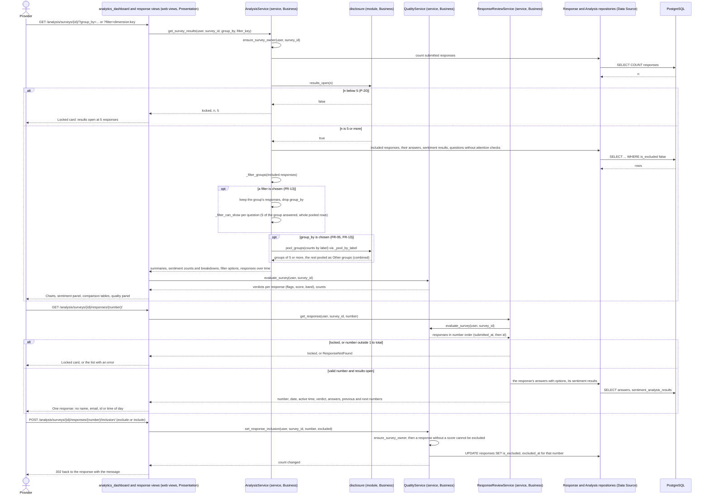

# Sequence diagram: UC-12 View analytics and one response (FR-05, FR-07, FR-09, FR-13)

```
Basis: team convention; diagrams/README.md (layers Presentation / Business / Data Source)
Source of truth: backend/apps/analysis/views.py (analytics_dashboard), backend/apps/analysis/response_views.py
  (response_detail, response_inclusion), backend/services/analysis_service.py (get_survey_results, _filter_groups,
  _filter_can_show, _sentiment_breakdown, _pool_by_label), backend/services/disclosure.py (results_open, pool_groups),
  backend/services/survey_access.py (ensure_survey_owner), backend/services/quality_service.py (evaluate_survey,
  set_response_inclusion), backend/services/response_review_service.py (get_response),
  backend/repositories/response_repository.py, backend/repositories/analysis_repository.py
Date / version: 2026-11-27, develop commit 59f1957
```

The provider opens the results of his survey. Under 5 submitted responses nothing is read but the count (P-20). From 5
on he sees the summaries of the included responses, the sentiment of open answers by group with small groups pooled
(FR-05, P-15), one optional filter (FR-13), and each response under a number, never under an id (FR-07, FR-09).



The provider never sees a respondent's name or email: the pages show demographic groups and numbers only (FR-09).
Excluding a response changes the charts and the export but not the response count, so it never locks the results
again (P-08). The sentiment labels come from the analysis worker (state-sentiment-result.md); a result still PENDING
or RUNNING counts as waiting.

## Legend

| Symbol | Meaning |
|---|---|
| Stick figure | Actor: the provider using the website. |
| Box at the top | Lifeline: one object or group of objects; the label names it and its layer. |
| Solid arrow (`->>`) | Call or HTTP request. |
| Dashed arrow (`-->>`) | Return value or HTTP response. |
| Arrow back to the same lifeline | Internal step of that object. |
| `alt` / `else` frame | Alternatives: only one branch runs, chosen by the condition. |
| `opt` frame | Optional part: runs only when its condition holds. |
| `302` | HTTP redirect after a form post. |
