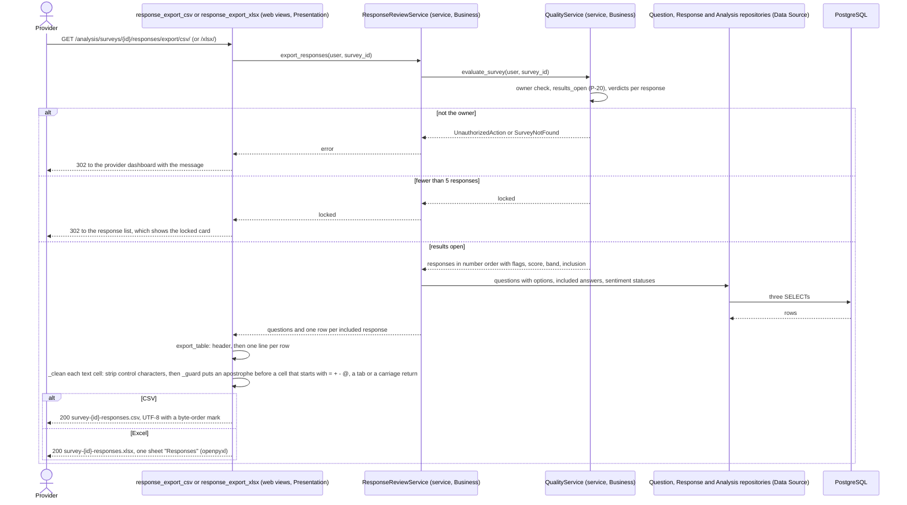

# Sequence diagram: UC-13 Export results (FR-14)

```
Basis: team convention; diagrams/README.md (layers Presentation / Business / Data Source)
Source of truth: backend/apps/analysis/export_views.py (response_export_csv, response_export_xlsx,
  _export_table_or_redirect, export_table, _clean, _guard), backend/services/response_review_service.py
  (export_responses), backend/services/quality_service.py (evaluate_survey), backend/repositories/
  (question, response and analysis repositories)
Date / version: 2026-11-27, develop commit 59f1957
```

The provider downloads the included responses of his survey with their quality verdicts, as CSV or as an Excel
workbook. Each row carries the response's list number, never its id; excluded responses keep their numbers but give
no row. Text cells are cleaned so that a spreadsheet never runs them as formulas.



The order of `_clean` matters: the control characters are stripped first, because a cell such as a bell character
followed by "=1" would pass the guard and then become the formula "=1" once stripped (D-226 (3)).

## Legend

| Symbol | Meaning |
|---|---|
| Stick figure | Actor: the provider using the website. |
| Box at the top | Lifeline: one object or group of objects; the label names it and its layer. |
| Solid arrow (`->>`) | Call or HTTP request. |
| Dashed arrow (`-->>`) | Return value or HTTP response with its status code. |
| Arrow back to the same lifeline | Internal step of that object. |
| `alt` / `else` frame | Alternatives: only one branch runs, chosen by the condition. |
| `200`, `302` | HTTP status codes. |
