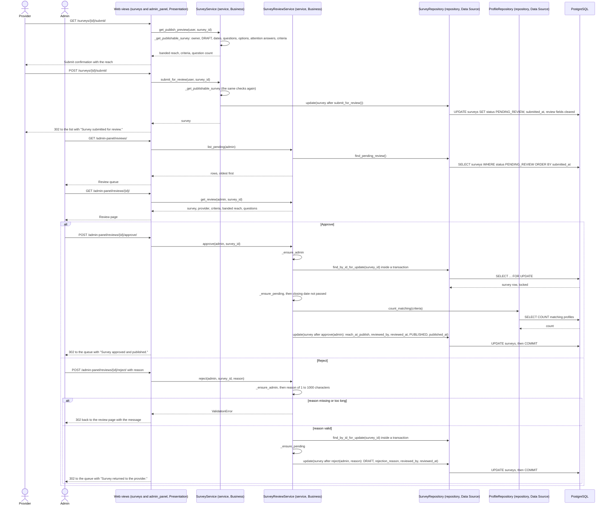

# Sequence diagram: UC-14 Review survey, with the provider's submit from UC-11 (FR-12)

```
Basis: team convention; diagrams/README.md (layers Presentation / Business / Data Source)
Source of truth: backend/apps/surveys/views.py (submit_for_review), backend/apps/admin_panel/views.py (review_queue,
  review_survey, approve_survey, reject_survey), backend/services/survey_service.py (submit_for_review,
  get_publish_preview, _get_publishable_survey), backend/services/survey_review_service.py (list_pending, get_review,
  approve, reject, _ensure_pending), backend/repositories/survey_repository.py (find_pending_review,
  find_by_id_for_update, update), backend/repositories/profile_repository.py (count_matching),
  backend/apps/core/models/survey.py (submit_for_review, approve, reject)
Date / version: 2026-11-27, develop commit 59f1957
```

A provider submits a complete draft; it waits as PENDING_REVIEW until an admin approves it (it is published at once)
or rejects it with a reason (it goes back to DRAFT). The state changes are in state-survey-lifecycle.md.



The row lock makes a second admin who decides on the same survey at the same moment wait; he then finds it no longer
pending and gets "This survey is no longer waiting for review." The reach stored at approval is unbanded on purpose:
every display of it goes through `disclosure.band`.

## Legend

| Symbol | Meaning |
|---|---|
| Stick figure | Actor: a person using the website (provider or admin). |
| Box at the top | Lifeline: one object; the label names the class and its layer. |
| Solid arrow (`->>`) | Call or HTTP request. |
| Dashed arrow (`-->>`) | Return value or HTTP response with its status code. |
| Arrow back to the same lifeline | Internal step of that object. |
| `alt` / `else` frame | Alternatives: only one branch runs, chosen by the condition. |
| `302` | HTTP redirect after a form post. |
