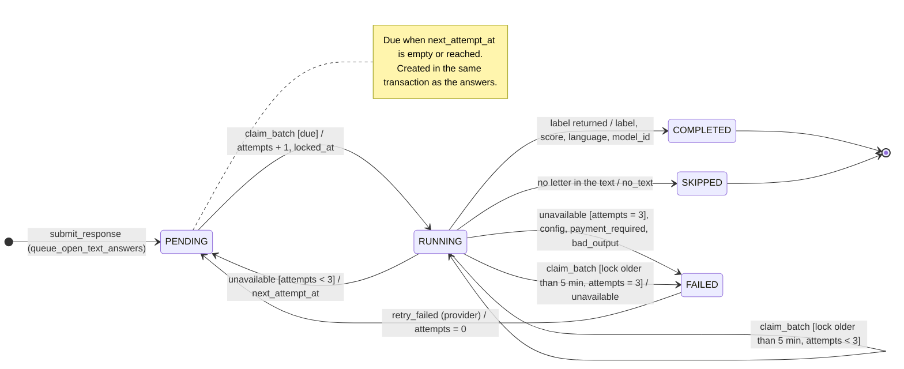

# State machine diagram: sentiment analysis result (Increment 2)

```
Basis: team convention (diagrams/README.md: requirement IDs and layer names); UML 2.5 state machine notation
Source of truth: backend/apps/core/models/sentiment_analysis_result.py (status and mark_completed, mark_failed,
  mark_skipped, schedule_retry), backend/core/enums.py (AnalysisStatus), backend/services/analysis_service.py
  (queue_open_text_answers, process_pending_batch, _analyse_claimed_result, retry_failed and the worker rules),
  backend/repositories/analysis_repository.py (create_pending, claim_batch, reset_failed), backend/core/exceptions.py
  (error codes), backend/services/text_language.py (detect_language)
Date / version: 2026-11-27, develop commit 59f1957
```

One `SentimentAnalysisResult` row exists for each open-text answer that has text (FR-05). The submit request only
creates it as PENDING; the analysis worker (`manage.py run_analysis_worker`, T-9) moves it on. The worker rules are
constants of `AnalysisService`: a batch of 8 rows, a lock timeout of 5 minutes, at most 3 attempts, and retry delays of
30 seconds after the first attempt and 120 seconds after the second.



## Transitions

| From | To | Trigger | Guard | Effect |
|---|---|---|---|---|
| (start) | PENDING | `ResponseService.submit_response` through `AnalysisService.queue_open_text_answers` | The answer is to an OPEN_TEXT question and its text is not blank | One row per answer, committed with the response. |
| PENDING | RUNNING | Worker, `AnalysisRepository.claim_batch` | Due: `next_attempt_at` empty or not after now; rows locked by another worker are skipped (`select_for_update(skip_locked=True)`) | `attempts` + 1, `locked_at` = now. |
| RUNNING | COMPLETED | Worker, `_analyse_claimed_result` | The analyzer returns a label that maps to POSITIVE, NEUTRAL or NEGATIVE | `sentiment_label`, `sentiment_score`, `analyzed_at`, `language` ("ar", "en" or "other"), `model_id`. |
| RUNNING | SKIPPED | Worker | `detect_language` finds no letter in the text | `error_code` = `no_text`. |
| RUNNING | PENDING | Worker, `schedule_retry` | `AnalysisUnavailable` and fewer than 3 attempts | `next_attempt_at` = now + 30 s or 120 s; lock cleared. |
| RUNNING | FAILED | Worker, `mark_failed` | `AnalysisUnavailable` at the third attempt; or `AnalysisConfigError`, `AnalysisPaymentRequired` or `AnalysisBadOutput` at any attempt (waiting does not cure them); or a label that does not map | `error_code` = `unavailable`, `config`, `payment_required` or `bad_output`; label and score cleared. |
| RUNNING | RUNNING | Worker, `claim_batch` | The lock is older than 5 minutes (a worker stopped mid-batch) and fewer than 3 attempts | Claimed again: `attempts` + 1, new `locked_at`. |
| RUNNING | FAILED | Worker, `claim_batch` | The lock is older than 5 minutes and 3 attempts are used | `error_code` = `unavailable`. |
| FAILED | PENDING | Provider, `AnalysisService.retry_failed` (button on the results page) | Owner of the survey; results open (at least 5 responses, P-20) | Every FAILED row of the survey: `attempts` = 0, due now, error cleared. |

COMPLETED and SKIPPED are final. The results page counts PENDING and RUNNING rows as "waiting" and shows the worker
hint when a due row is more than 2 minutes old or a lock is older than 5 minutes (`AnalysisService.analysis_overdue`).

## Legend

| Symbol | Meaning |
|---|---|
| Rounded box | State: a value of `SentimentAnalysisResult.status` (`AnalysisStatus`). |
| Filled circle `[*]` | Initial pseudostate: the row is created. |
| Arrow to `[*]` | The state is final: nothing changes the row again. |
| Arrow with a label | Transition: `event [guard] / effect`. |
| Arrow from a state to itself | Self-transition: the row stays RUNNING but is claimed again by a worker. |
| Note | Comment attached to a state. |
