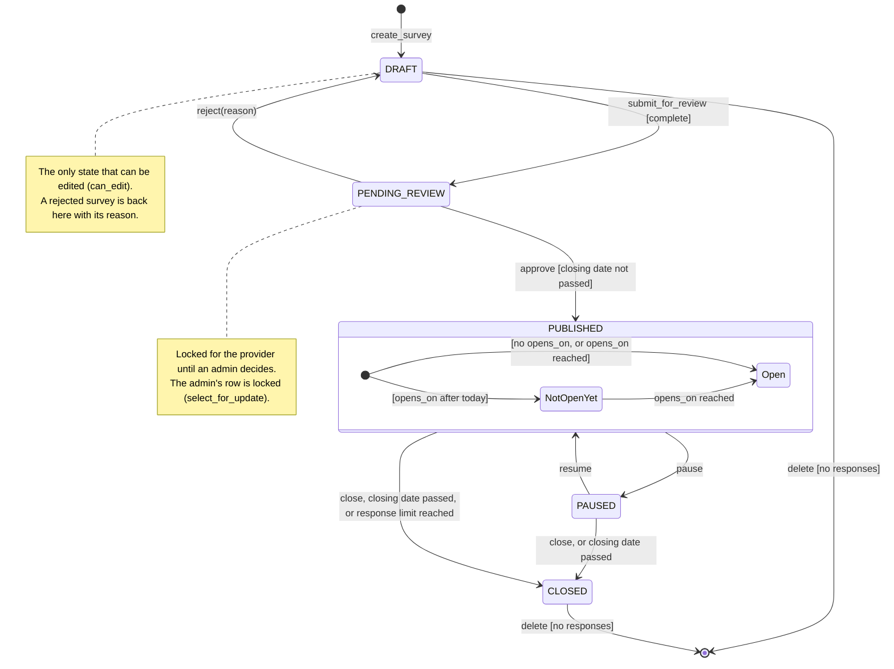

# State machine diagram: survey lifecycle (Increment 2)

```
Basis: team convention (diagrams/README.md: requirement IDs and layer names); UML 2.5 state machine notation
Source of truth: backend/apps/core/models/survey.py (status and the transition methods), backend/core/enums.py
  (SurveyStatus), backend/services/survey_service.py (submit_for_review, close_survey, pause_survey, resume_survey,
  delete_survey, list_provider_surveys, get_provider_survey), backend/services/survey_review_service.py (approve,
  reject), backend/services/response_service.py (_ensure_open, submit_response), backend/services/admin_service.py
  (generate_system_report), backend/repositories/survey_repository.py (close_past_end, find_eligible_for_respondent)
Date / version: 2026-11-27, develop commit 59f1957
```

The five values of `Survey.status` and every transition the code makes between them. FR-12 added PENDING_REVIEW
(migration 0015), FR-11 added PAUSED and the closing by date or by response limit (migration 0016). Who triggers each
transition and the guard it checks are in the table below the diagram.



## Transitions

| From | To | Trigger (who, where) | Guard | Effect |
|---|---|---|---|---|
| (start) | DRAFT | Provider, `SurveyService.create_survey` | Provider account | `created_at`; schedule and limit checked if given. |
| DRAFT | PENDING_REVIEW | Provider, `SurveyService.submit_for_review` | Owner; at least one question; every multiple-choice question has two options; every attention check has its expected answer; targeting criteria exist; the closing date is not in the past | `submitted_at`; the last review is cleared. |
| PENDING_REVIEW | PUBLISHED | Admin, `SurveyReviewService.approve` | Admin; the survey is still pending (row lock); the closing date has not passed | `reviewed_by`, `reviewed_at`, `reach_at_publish` (unbanded, P-19), `published_at`. |
| PENDING_REVIEW | DRAFT | Admin, `SurveyReviewService.reject` | Admin; a reason of 1 to 1000 characters; still pending | `rejection_reason`, `reviewed_by`, `reviewed_at`. |
| PUBLISHED | PAUSED | Provider, `SurveyService.pause_survey` | Owner; status PUBLISHED | Takes no response; not in the respondents' list. |
| PAUSED | PUBLISHED | Provider, `SurveyService.resume_survey` | Owner; status PAUSED | Takes responses again. |
| PUBLISHED or PAUSED | CLOSED | Provider, `SurveyService.close_survey` | Owner; status PUBLISHED or PAUSED | `closed_at`. |
| PUBLISHED or PAUSED | CLOSED | System, `SurveyRepository.close_past_end`, run when a provider lists or opens surveys and when an admin builds the system report | `closes_on` before today | One UPDATE; `closed_at`. |
| PUBLISHED | CLOSED | System, `ResponseService.submit_response` | The submitted response reaches `target_responses` (every submitted response counts, excluded ones too, P-08) | In the same transaction as the response, under the survey's row lock. |
| DRAFT or CLOSED | (end) | Provider, `SurveyService.delete_survey` | Owner; no response exists (P-06) | The survey and its parts are deleted. |

Inside PUBLISHED a survey takes responses only between its dates: before `opens_on` it is published but not open
(not listed, and a submit answers "This survey is not open yet."). This is the composite state in the diagram; it is
not stored, it is computed from the date (`Survey.is_open_on`, `ResponseService._ensure_open`,
`SurveyRepository.find_eligible_for_respondent`).

A survey past its closing date that nobody has read since still holds PUBLISHED or PAUSED in the database until the
next provider or admin read closes it; until then the respondents' list and the submit check already treat it as
closed, because both compare `closes_on` with today.

## Legend

| Symbol | Meaning |
|---|---|
| Rounded box | State: a value of `Survey.status`. |
| Filled circle `[*]` | Initial pseudostate (at the top level: the survey is created; inside PUBLISHED: entry). |
| Arrow to `[*]` | Final state: the survey row is deleted. |
| Arrow with a label | Transition: `event [guard]`. The event is a service method or a system rule; the guard is the condition checked before it. |
| Box inside PUBLISHED | Composite state: substates computed from `opens_on`, not stored. |
| Note | Comment attached to a state. |
